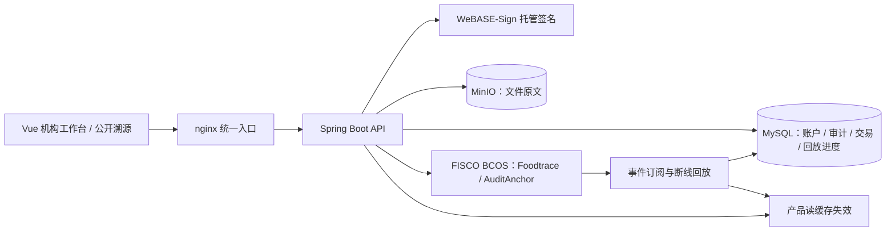
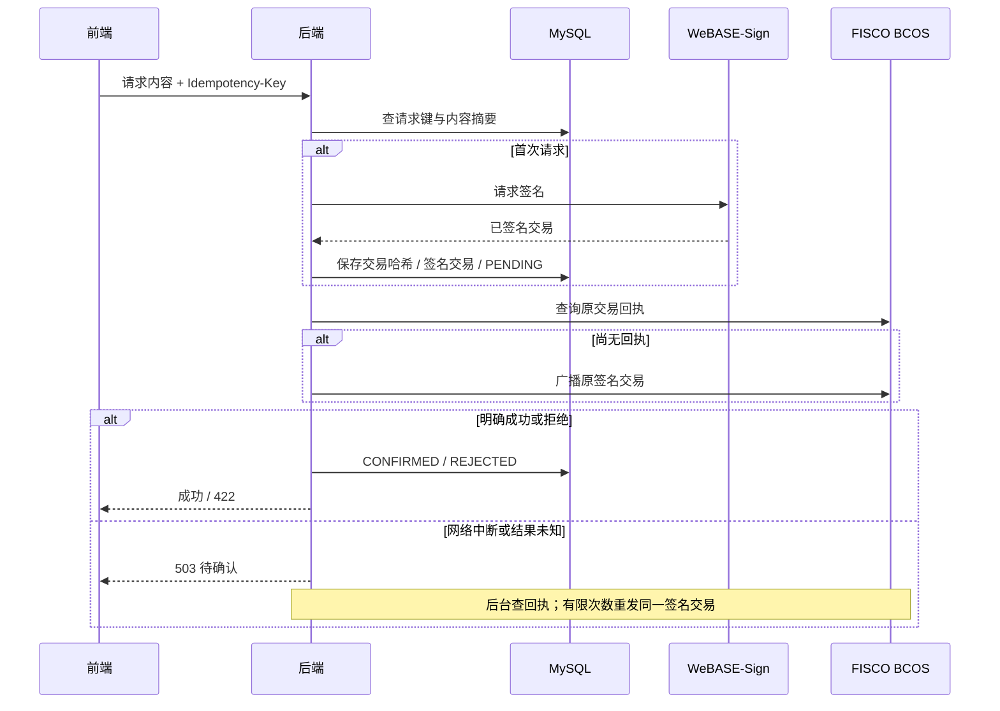
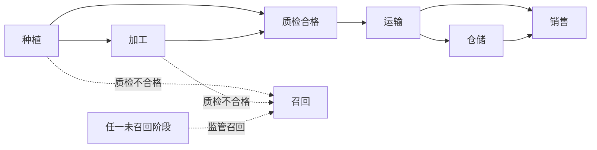

# 架构与一致性边界

## 哪一层负责什么

| 数据或规则 | 权威来源 | 其他层的作用 |
|---|---|---|
| 产品责任方、流转阶段、质检、召回 | Foodtrace 合约 | 后端前置校验，缓存加速读取 |
| 平台登录、账户启用状态 | MySQL 账户表 | JWT 过滤器每次核对账户状态 |
| 机构链角色 | Foodtrace 合约 | 后端审批、定期对账；冲突不自动改链 |
| 文件内容 | MinIO 原文 + 链上摘要 | 上传算哈希，上链前与下载时重算，浏览器再次核验 |
| 后端操作历史 | MySQL 审计哈希链 + AuditAnchor 历史锚 | 校验已锚历史前缀，允许正常追加 |
| 交易是否执行成功 | 原交易哈希对应的链上回执 | MySQL 保存请求标识、签名交易及恢复状态 |

合约不直接读取 MinIO。文件存在性检查发生在后端；绕过后端直接发链上交易，
仍只受合约规则约束。事件订阅负责记录这类外部交易并使相关读缓存失效。
哈希一致不等于内容真实，检测过程与机构身份真实性需要线下制度保障。

## 写链恢复流程

签名服务、MySQL、区块链之间没有分布式事务。数据库写交易日志失败时不广播；
广播后中断则依据原哈希恢复。审批先保存开户身份与拟授角色，对账确认链角色一致后
可补齐本地账户状态。产品回读或完整业务审计失败时仍需用原请求重试；事件回放可补记
链上事件，但不能凭事件恢复所有用户输入。

## 业务状态

图中的状态变化由记录/质检写入推进，交接另行改变当前责任方。
不能跳过质检或运输；允许原材料直接送检及运输后直接交给零售。
销售后不能继续普通流转，监管仍可召回；召回后所有产品写操作都被拒绝。

## 当前规模与信任假设

- 按单后端实例部署。审计接链、审批串行和内存限流尚未具备多实例协调能力。
- 普通列表按 id 截取当前页；组合筛选遍历产品读缓存。大规模检索应建立可重建的事件查询索引。
- 产品缓存默认有效期一分钟，交易成功和订阅事件主动失效；短暂读旧数据仍是需要考虑的边界。
- 回放游标按群组与合约隔离，包含最后处理区块以覆盖同区块剩余事件；审计通过交易哈希去重。
- 新锚必须延续旧锚。它能检测数据库篡改，但不抵御掌握监管签名权、能够任意调用锚定合约的攻击者。
- 未配置 AuditAnchor 时不执行锚定，不能宣传具有链外审计的链上锚保护。
- Hardhat 用于合约规则回归；FISCO 的部署、签名、时间戳与断线恢复仍需在实际环境联调。
